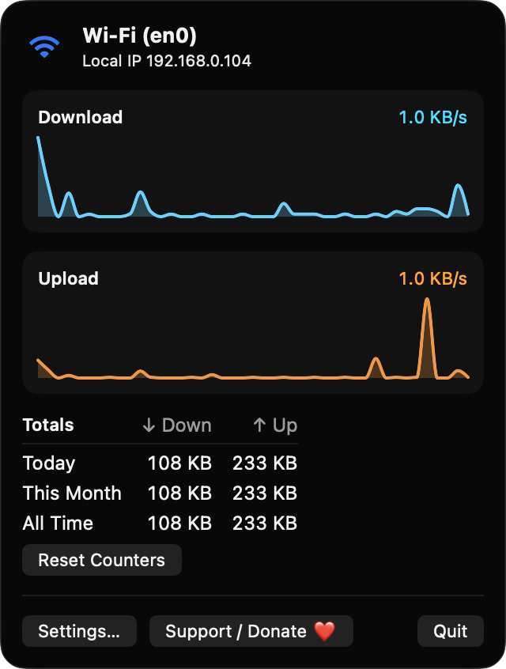
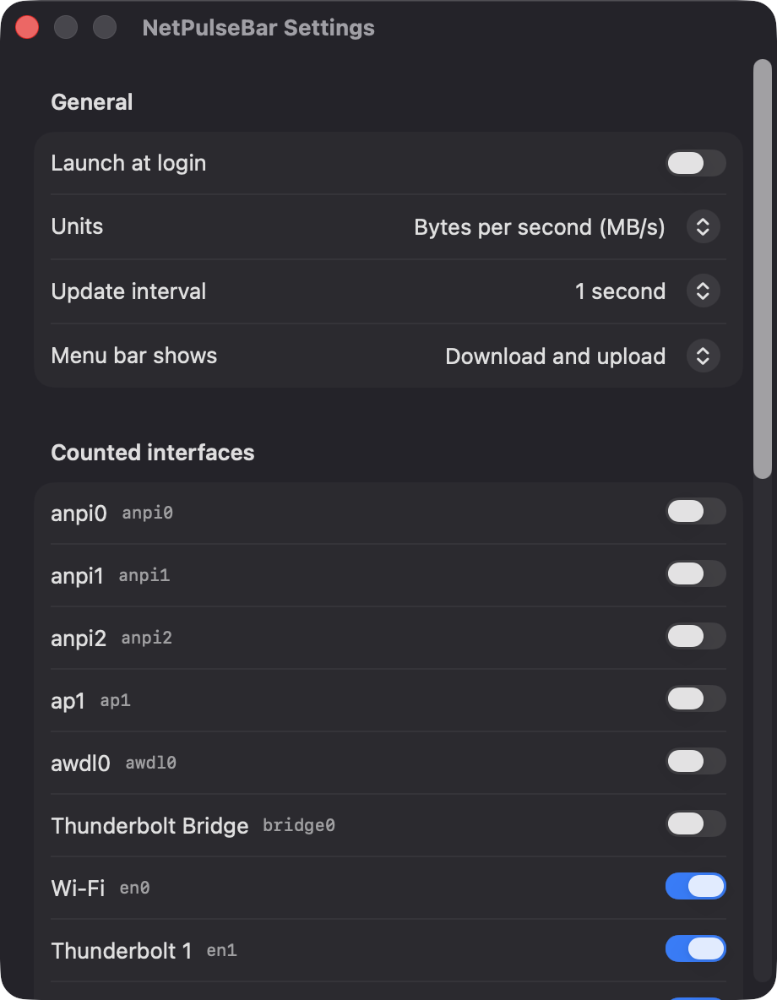
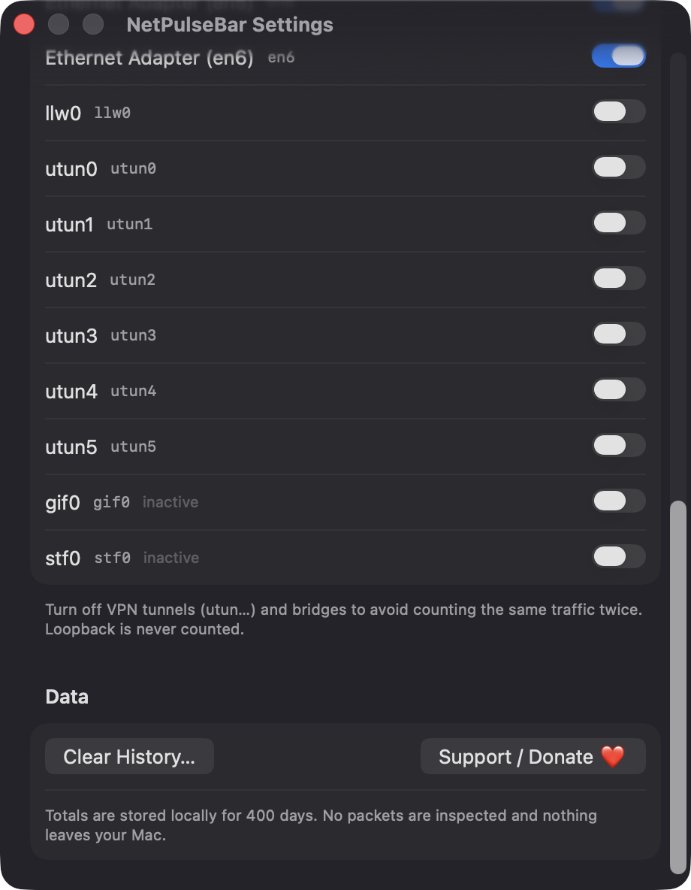

# NetPulseBar

**🌐 Website:** [turhe123.github.io/net-pulse-bar](https://turhe123.github.io/net-pulse-bar/)

See live upload and download speed in the menu bar, with per-day totals and a tiny history graph.

> 🆓 A free, open-source **Bandwidth+ alternative** for macOS 14+. Native Swift, no accounts, no subscriptions, MIT licensed.


## Why

NetPulseBar is a free, open-source, 100% native, backend-free alternative to paid utilities in the *System Monitoring* category. It was inspired by apps such as Bandwidth+ ($4.99 one-time), and aims to do one thing well: show your network speed and usage in the menu bar. It is written in Swift with SwiftUI and AppKit, has no third-party dependencies, and keeps all data on your Mac.

## Features

- **Live speeds in the menu bar**: download (↓) and upload (↑) rates, shown with a monospaced-digit font so the label doesn't jitter. Shows "—" before the first sample and "Offline" when there is no connection.
- **Menu bar display mode**: show both directions, download only, or upload only.
- **Bytes or bits**: switch between bytes per second and bits per second.
- **Sparkline history**: a popover with separate Download and Upload cards, each charting the last 60 seconds with Swift Charts.
- **Connection info**: active interface name (for example Wi-Fi or Ethernet) and your local IPv4 address.
- **Usage totals**: downloaded and uploaded bytes for Today, This Month and All Time, with a Reset Counters button.
- **Update interval**: sample every 1, 2 or 5 seconds.
- **Choose which interfaces count**: physical interfaces (`en*`, cellular/tethering) are counted by default; VPN tunnels, bridges and AirDrop links are off by default to avoid double counting. Loopback is never counted.
- **Robust counting**: handles 32-bit counter wraparound, ignores counter resets, discards the first sample after wake from sleep, and picks up interfaces that appear or vanish (such as USB tethering).
- **Local storage**: daily totals are saved as JSON in `~/Library/Application Support/NetPulseBar/usage.json`, kept for 400 days, and saved periodically, before sleep and on quit. A Clear History button deletes them.
- **Launch at login** via `SMAppService`.
- **Private**: no packets are inspected and nothing leaves your Mac.

## Screenshots

<p align="center"></p>

<p align="center"><em>The menu bar popover shows the active Wi-Fi interface and local IP, live download and upload sparklines for the last 60 seconds, and usage totals for today, this month and all time.</em></p>

<p align="center"></p>

<p align="center"><em>Settings let you toggle launch at login, choose bytes or bits, set the update interval, pick what the menu bar shows, and select which network interfaces are counted.</em></p>

<p align="center"></p>

<p align="center"><em>VPN tunnels and bridges are off by default to avoid double counting, and totals stay on your Mac with a one-click Clear History.</em></p>

## Install

1. Download `NetPulseBar-macOS.zip` from the [latest release](https://github.com/turhe123/net-pulse-bar/releases/latest).
2. Unzip it and move `NetPulseBar.app` to `/Applications`.
3. Because the app is open source and not notarized, clear the quarantine attribute:

   ```bash
   xattr -cr /Applications/NetPulseBar.app
   ```

4. Right-click the app and choose **Open** the first time you launch it.

Requires macOS 14.0 or later.

## Build from source

You need Xcode with the macOS SDK and [XcodeGen](https://github.com/yonaskolb/XcodeGen).

```bash
brew install xcodegen
xcodegen generate
xcodebuild -project NetPulseBar.xcodeproj -scheme NetPulseBar -configuration Release -derivedDataPath ./build build
```

The app is produced at `build/Build/Products/Release/NetPulseBar.app`.

## Permissions

NetPulseBar doesn't request Accessibility, Screen Recording, Microphone, Camera, Location or any other privacy permission. Byte counters are read with `getifaddrs`, connectivity comes from `NWPathMonitor`, and friendly interface names come from SystemConfiguration, none of which need a prompt.

The only system interaction is the optional **Launch at login** toggle. macOS may ask you to approve the login item in System Settings › General › Login Items.

## Support ❤️

If NetPulseBar is useful to you, you can support its development:

[Support Or (Leo) Davidai ❤️](https://ko-fi.com/leodavidai)

The app also has a "Support / Donate ❤️" button in the popover and in Settings.

## More free Mac apps

NetPulseBar is one of [60 free, open-source Mac utilities](https://github.com/turhe123/mac-apps) built the same way: native Swift, no accounts, no telemetry. Browse the full gallery at [turhe123.github.io/mac-apps](https://turhe123.github.io/mac-apps/).

## License

MIT © Or Davidai Bachar
